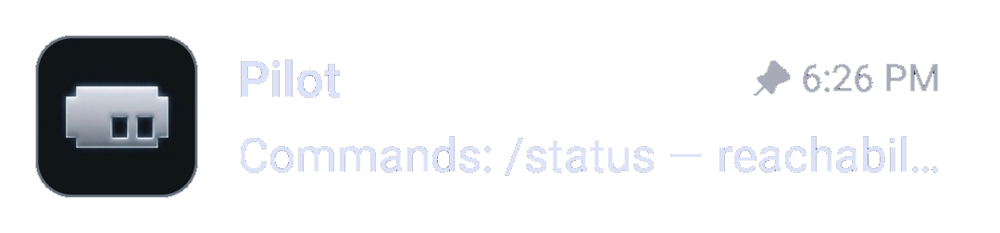

# Botile

[Русская версия](ru/README.ru.md)

Botile gives Telegram bot avatars a rounded-square shape with a customizable
outline. Other avatars keep the shape chosen by the client.

The shape is there for one practical reason: bots are easy to tell apart from
people and channels at a glance, in a chat list or in a group where everyone
writes at once.

## Features

- Rounded-square bot avatars.
- Theme-aware outline palette: Theme, Accent, White, Black.
- Adjustable outline thickness.
- Settings labels follow the client language: Russian or English, with English
  fallback.

## Compatibility

- exteraGram (main target)
- exteraless `>= 12.10.6` and AyuGram — same plugin API, not tested by us
- Plugin SDK `>= 1.4.5.3`
- Version `1.0.0`

## License

MIT — see [LICENSE](LICENSE.md).
