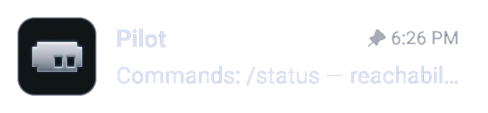

# Botile

[English version](../README.md)

Botile придаёт аватарам Telegram-ботов скруглённую квадратную форму с
настраиваемой обводкой. Остальные аватары сохраняют форму, выбранную клиентом.

Форма нужна для одной практической вещи: ботов легко отличить от людей и каналов
с первого взгляда — в списке чатов или в группе, где все пишут одновременно.

## Возможности

- Скруглённые квадратные аватары ботов.
- Адаптивная к теме палитра обводки: «Тема», «Акцент», «Белая», «Чёрная».
- Настраиваемая толщина обводки.
- Подписи настроек следуют языку клиента: русский или английский, с fallback
  на английский.

## Совместимость

- exteraGram (основная цель)
- exteraless `>= 12.10.6` и AyuGram — тот же API плагинов, нами не тестировались
- SDK плагинов `>= 1.4.5.3`
- Версия `1.0.0`

## Лицензия

MIT — см. [LICENSE.ru.md](LICENSE.ru.md).
